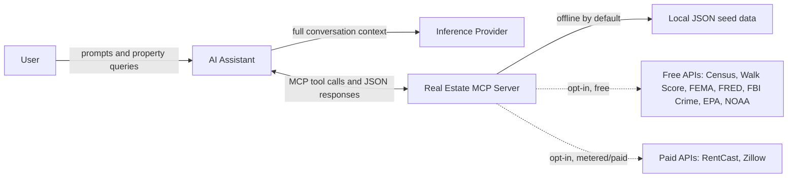

# Real Estate MCP Server — Property Intelligence & Workflow Automation

A [Model Context Protocol](https://modelcontextprotocol.io) (MCP) server for
structured real estate workflows. This **real estate MCP server** provides
tools, resources, and prompts for property search and insights, agent/client
management, market and area intelligence, **mortgage/affordability math,
comparable-based valuation, investment analysis, and listing-document
ingestion** — all backed by a deterministic, offline-first engine and optional
**opt-in live data integrations**: free sources (Census, Walk Score, FEMA,
FRED, FBI Crime Data, EPA, NOAA) and paid/metered sources (RentCast, Zillow).

> **This server provides workflow augmentation, not financial, legal, or
> appraisal advice.** Always consult qualified professionals for investment and
> valuation decisions.

- **Status:** V2.0 — fully implemented and tested (50+ tools across 11 categories).
- **Transport:** stdio (default), SSE, and streamable-HTTP (via FastMCP).
- **Runtime:** Python 3.10+ and the official `mcp` SDK.

## Contents

- [Data flow & privacy boundaries](#data-flow--privacy-boundaries)
- [⚠️ RentCast metered API (read first)](#️-rentcast-metered-api-read-first)
- [Repository structure](#repository-structure)
- [🚀 Quick start](#-quick-start)
- [🧰 Capabilities](#-capabilities)
- [Feature flags (tool categories)](#feature-flags-tool-categories)
- [🔌 Live integrations](#-live-integrations)
- [🐳 Docker](#-docker)
- [🧪 Testing, linting & types](#-testing-linting--types)
- [🛠️ Development](#️-development)
- [📖 Further reading](#-further-reading)
- [Integration & development support](#integration--development-support)
- [License](#license)

---

## Data flow & privacy boundaries

Understanding **where data goes** before connecting this server to an AI
assistant or enabling live integrations:



| Boundary | What crosses it | Default behavior | Note |
| --- | --- | --- | --- |
| **You → AI assistant** | Prompts, property queries, tool results pasted into chat | Always active when using an AI client | Your inference provider's ToS governs data retention |
| **AI assistant → MCP server** | Tool arguments (addresses, criteria, client IDs) and JSON responses | Local transport (stdio/SSE/HTTP on your machine) | Tool calls are audit-logged locally via `utils.audit()` |
| **MCP server → external APIs** | Search queries to Census, Walk Score, FEMA, FRED, FBI Crime Data, EPA, NOAA, RentCast, or Zillow | **Disabled by default** | Enable only when needed; RentCast and Zillow are metered/paid (see below) |

**Key takeaway:** this MCP server is **offline and deterministic by default**.
The highest privacy risk is the **inference provider** receiving your full
prompt context — including property data returned by these tools.

---

## ⚠️ RentCast metered API (read first)

**If you connect this MCP server (or an AI assistant using it) to RentCast or
Zillow, you are responsible for all charges incurred on your account.**
RentCast bills per API call, Zillow access requires a paid enterprise data
license, and AI agents can issue many requests in a short session.

To protect you from surprise charges, **every live integration is disabled by
default** and must be explicitly enabled with a feature flag and (where
required) an API key — see [Live integrations](#-live-integrations). Prefer
the **free** sources (Census, Walk Score, FEMA, FRED, FBI Crime Data, EPA,
NOAA) wherever possible; RentCast and Zillow are metered/paid.

---

## Repository structure

| Folder / File | Purpose |
|---|---|
| [`main.py`](main.py) | `create_server()` factory + transport CLI; module-level `mcp` object |
| [`utils.py`](utils.py) | `RealEstateDataManager`, `audit()`, `get_data_manager()` singleton |
| [`feature_flags.py`](feature_flags.py) | Category-level `REALESTATE_MCP_ENABLE_*` environment flags |
| [`tools/`](tools/) | MCP tool implementations (50+ tools across 11 categories) |
| [`tools/finance_helpers.py`](tools/finance_helpers.py) | Pure, deterministic finance math — fully unit-tested |
| [`resources/`](resources/) | MCP resource endpoints (`realestate://` URIs) |
| [`prompts/`](prompts/) | 13 workflow prompt templates |
| [`integrations/`](integrations/) | Optional live-data adapters (free: Census, Walk Score, FEMA, FRED, FBI Crime, EPA, NOAA; paid: RentCast, Zillow) — disabled by default |
| [`data/`](data/) | Offline JSON seed data (properties, agents, clients, markets, areas) |
| [`tests/`](tests/) | pytest suite — unit + integration, fully network-free |
| [`.agents/`](.agents/) | Vendor-agnostic agent skill (real-estate-mcp-toolkit) |

<details>
<summary>Expand full directory tree</summary>

```
real-estate-mcp/
├── main.py
├── utils.py
├── feature_flags.py
├── tools/
│   ├── property_tools.py       # search, filter, insights
│   ├── agent_tools.py          # profiles, dashboards
│   ├── market_tools.py         # market analytics, sales
│   ├── client_tools.py         # client management + matching
│   ├── area_tools.py           # area intelligence + amenities
│   ├── mortgage_tools.py       # payment, amortization, affordability, refinance
│   ├── valuation_tools.py      # CMA valuation + investment analysis
│   ├── document_tools.py       # listing ingestion + .docx report export
│   ├── analysis_queue_tools.py # SQLite-backed async analysis queue
│   ├── deep_analysis_tools.py  # MCP sampling with heuristic fallback
│   ├── integration_tools.py    # live integration status + lookups
│   ├── system_tools.py         # data refresh, server info, summaries
│   ├── finance_helpers.py      # shared pure finance math
│   └── __init__.py             # register_all_tools() (feature-flagged)
├── resources/
├── prompts/
├── integrations/
├── data/
│   ├── properties/
│   ├── agents/
│   ├── clients/
│   ├── market/
│   ├── transactions/
│   ├── areas/
│   └── amenities/
└── tests/
    ├── conftest.py
    ├── unit/
    └── integration/
```

</details>

---

## 🚀 Quick start

```bash
# 1. Clone the repository
git clone https://github.com/agentic-ops/real-estate-mcp.git
cd real-estate-mcp

# 2. (Recommended) create a virtual environment
python -m venv .venv
source .venv/bin/activate          # Windows: .venv\Scripts\activate

# 3. Install dependencies
pip install -r requirements.txt

# 4. Run the server (stdio — ideal for Claude Desktop)
python main.py
```

Run over a different transport:

```bash
python main.py --transport sse              # SSE on http://127.0.0.1:8000/sse
python main.py --transport streamable-http  # modern HTTP transport
python main.py --transport sse --port 9000  # custom port
```

All flags also read from environment variables: `MCP_TRANSPORT`, `HOST`,
`PORT`, `LOG_LEVEL`.

### Claude Desktop

Edit your Claude Desktop config file:

- **macOS:** `~/Library/Application Support/Claude/claude_desktop_config.json`
- **Windows:** `%APPDATA%\Claude\claude_desktop_config.json`

```json
{
  "mcpServers": {
    "real-estate": {
      "command": "/absolute/path/to/.venv/bin/python",
      "args": ["/absolute/path/to/real-estate-mcp/main.py"],
      "env": { "PYTHONUNBUFFERED": "1" }
    }
  }
}
```

Or install via the MCP CLI: `mcp install main.py --name "Real Estate"`.

### MCP Inspector

```bash
# Load the module-level server object directly
mcp dev main.py:mcp

# Or point the Inspector at a running SSE server
DANGEROUSLY_OMIT_AUTH=true MCP_AUTO_OPEN_ENABLED=false npx -y @modelcontextprotocol/inspector
# In the Inspector: Transport = SSE, URL = http://127.0.0.1:8000/sse
```

### Example prompts to try with Claude

> *"What properties are available in Downtown Riverside?"*
> *"Show me homes between $500k and $1M with 3+ bedrooms."*
> *"Calculate mortgage payments on a $750k home with 20% down at 6.5%."*
> *"Give me a CMA valuation for property PROP001."*
> *"What's the investment return on a rental at $850k with $3,200/month rent?"*
> *"Show me Sarah Chen's agent performance dashboard."*

---

## 🧰 Capabilities

### 🏠 Tools (50+)

| Category | Env flag | Tools |
|---|---|---|
| **Property** | `REALESTATE_MCP_ENABLE_PROPERTY` | `search_properties`, `filter_properties`, `get_property_details`, `get_property_insights`, `get_properties_by_area`, `get_properties_by_agent` |
| **Agent** | `REALESTATE_MCP_ENABLE_AGENT` | `get_agent_profile`, `get_all_agents`, `get_agent_dashboard`, `get_agent_clients`, `get_agent_properties`, `get_agent_sales` |
| **Market** | `REALESTATE_MCP_ENABLE_MARKET` | `get_market_overview`, `get_area_market`, `get_recent_sales`, `get_investment_opportunities`, `compare_areas`, `get_price_trends`, `get_market_summary` |
| **Client** | `REALESTATE_MCP_ENABLE_CLIENT` | `get_client_profile`, `get_all_clients`, `match_client_preferences` |
| **Area** | `REALESTATE_MCP_ENABLE_AREA` | `get_comprehensive_area_report`, `get_area_demographics`, `get_schools_data`, `get_parks_data`, `get_shopping_data`, `get_healthcare_data`, `get_city_overview`, `get_area_comparison`, `get_amenities_summary` |
| **Mortgage** | `REALESTATE_MCP_ENABLE_MORTGAGE` | `calculate_mortgage_payment`, `generate_amortization_schedule`, `estimate_affordability_tool`, `compare_loan_scenarios`, `compare_refinance` |
| **Valuation** | `REALESTATE_MCP_ENABLE_VALUATION` | `estimate_property_value`, `analyze_investment`, `deep_analyze_property` |
| **Document** | `REALESTATE_MCP_ENABLE_DOCUMENT` | `ingest_listing_document`, `export_property_report` |
| **Analysis Queue** | `REALESTATE_MCP_ENABLE_ANALYSIS_QUEUE` | `queue_property_analysis`, `get_analysis_status`, `get_analysis_result`, `list_analysis_jobs` |
| **Integrations** | `REALESTATE_MCP_ENABLE_INTEGRATIONS` | `integration_status`, `lookup_live_property`, `lookup_live_zestimate`, `get_live_demographics`, `get_live_walk_score`, `get_live_flood_zone`, `get_live_mortgage_rate`, `get_live_crime_summary`, `get_live_environmental_hazards`, `get_live_weather_forecast` |
| **System** | `REALESTATE_MCP_ENABLE_SYSTEM` | `get_server_info`, `refresh_data`, `get_data_summary` |

**Highlights:**
- **Deterministic finance engine** (`tools/finance_helpers.py`): mortgage payments, amortization schedules, affordability, and investment metrics — pure functions, fully unit-tested.
- **Comparable-based CMA valuation** using local sales data.
- **Listing-document ingestion** of `.txt`/`.docx` files with `.docx` report export.
- **Async analysis queue** backed by SQLite for batch listing analysis.
- **MCP sampling** support: `deep_analyze_property` asks the connected client's LLM for deeper reasoning, with a deterministic heuristic fallback when sampling is unavailable.

### 📡 Resources

Static (always available):

- `realestate://server-config` — enabled categories and feature-flag env var names
- `realestate://all-properties` — complete property listings
- `realestate://all-agents` — agent directory
- `realestate://market-overview` — current market trends
- `realestate://all-areas` — area information
- `realestate://amenities` — complete amenities database
- `realestate://integrations/status` — live-integration status (flags/config)

Dynamic resource templates:

- `realestate://properties/area/{area}`
- `realestate://agent/{agent_id}/dashboard`
- `realestate://market/area/{area}`
- `realestate://property/{property_id}/insights`
- `realestate://client/{client_id}/matches`

### 💬 Prompts (13)

`property_analysis`, `property_comparison`, `client_matching`,
`client_consultation`, `client_feedback_analysis`, `market_report`,
`investment_analysis`, `comparative_market_analysis`, `agent_performance`,
`agent_marketing_strategy`, `agent_training_development`,
`mortgage_planning_prompt`, `valuation_prompt`.

See [`WORKFLOW_EXAMPLES.md`](WORKFLOW_EXAMPLES.md) for end-to-end workflow
walkthroughs.

---

## Feature flags (tool categories)

Every tool category is **enabled by default**. Set a
`REALESTATE_MCP_ENABLE_*` environment variable to `false` (or `0`/`no`/`off`)
before starting the server to disable an entire category — its tools and
matching resources will not be registered.

Check the current state at any time via `realestate://server-config` or the
`get_server_info` tool.

| Category | Environment variable | What it controls |
|---|---|---|
| Property | `REALESTATE_MCP_ENABLE_PROPERTY` | Property search, filter, and insights tools + resources |
| Agent | `REALESTATE_MCP_ENABLE_AGENT` | Agent profile, dashboard, and performance tools |
| Market | `REALESTATE_MCP_ENABLE_MARKET` | Market overview, trends, and comparative analysis tools |
| Client | `REALESTATE_MCP_ENABLE_CLIENT` | Client profiles and property-matching tools |
| Area | `REALESTATE_MCP_ENABLE_AREA` | Area intelligence, demographics, amenities, and school data |
| Mortgage | `REALESTATE_MCP_ENABLE_MORTGAGE` | Payment calculation, amortization, affordability, refinance |
| Valuation | `REALESTATE_MCP_ENABLE_VALUATION` | CMA valuation, investment analysis, deep property analysis |
| Document | `REALESTATE_MCP_ENABLE_DOCUMENT` | Listing ingestion and `.docx` report export |
| Analysis Queue | `REALESTATE_MCP_ENABLE_ANALYSIS_QUEUE` | SQLite-backed async batch analysis queue |
| Integrations | `REALESTATE_MCP_ENABLE_INTEGRATIONS` | Live integration status and lookup tools |
| System | `REALESTATE_MCP_ENABLE_SYSTEM` | Server info, data refresh, and summary tools |

Example — disable the analysis queue only:

```bash
export REALESTATE_MCP_ENABLE_ANALYSIS_QUEUE=false
python main.py
```

See [`.env.example`](.env.example) for a copy-paste template including live
integration credentials.

**Note on `deep_analyze_property`:** this tool uses MCP
`sampling/createMessage` to ask the connected client's LLM for deeper
reasoning. When the client does not advertise sampling support (common in
Cursor and Claude Desktop today), the tool returns the same heuristic
analysis plus an explanatory note — not an error.

---

## 🔌 Live integrations

Live data sources are **optional and disabled by default**. Each is controlled
by a **feature flag** plus (where required) **credentials**, all supplied via
environment variables. Check the current state at any time:

```bash
# via the tool
integration_status

# or the resource
realestate://integrations/status
```

`integration_status` and the resource return only booleans and non-sensitive
metadata — **credentials are never echoed back**.

| Source | Cost | Enable flag | Credentials | Tool(s) |
|---|---|---|---|---|
| [Census Bureau](https://api.census.gov/data/key_signup.html) | Free (key required) | `CENSUS_ENABLED` | `CENSUS_API_KEY` (required) | `get_live_demographics` |
| [Walk Score](https://www.walkscore.com/professional/api.php) | Free up to 5,000 calls/day | `WALKSCORE_ENABLED` | `WALKSCORE_API_KEY` (required) | `get_live_walk_score` |
| [FEMA NFHL](https://hazards.fema.gov/arcgis/rest/services/public/NFHL/MapServer) | Free (keyless) | `FEMA_ENABLED` | none | `get_live_flood_zone` |
| [FRED](https://fredaccount.stlouisfed.org/apikeys) | Free | `FRED_ENABLED` | `FRED_API_KEY` (required) | `get_live_mortgage_rate` |
| [FBI Crime Data](https://api.data.gov/signup/) | Free | `FBI_CRIME_ENABLED` | `FBI_CRIME_API_KEY` (required) | `get_live_crime_summary` |
| [EPA Envirofacts](https://www.epa.gov/enviro/envirofacts-data-service-api) | Free (keyless) | `EPA_ENABLED` | none | `get_live_environmental_hazards` |
| [NOAA/NWS](https://www.weather.gov/documentation/services-web-api) | Free (keyless) | `NOAA_ENABLED` | none | `get_live_weather_forecast` |
| [RentCast](https://rentcast.io) | **Metered; may incur cost** | `RENTCAST_ENABLED` | `RENTCAST_API_KEY` (required) | `lookup_live_property` |
| [Zillow (Bridge Interactive)](https://www.bridgeinteractive.com/developers/zillow-group-data/) | **Paid/enterprise; requires an approved data license** | `ZILLOW_ENABLED` | `ZILLOW_API_KEY` (required) | `lookup_live_zestimate` |

### Free sources

Census, Walk Score, FEMA, FRED, FBI Crime Data, EPA, and NOAA are all free.
Most (Census, Walk Score, FRED, FBI Crime Data) require a free API key to
authenticate or raise rate limits -- Census in particular now **rejects every
keyless request** (verified live; this changed from its historical
"optional key" policy). FEMA, EPA, and NOAA are fully keyless.

```bash
export CENSUS_ENABLED=true
export CENSUS_API_KEY="your-key-here"   # required -- Census now rejects keyless requests

export WALKSCORE_ENABLED=true
export WALKSCORE_API_KEY="your-key-here"

export FEMA_ENABLED=true          # no key needed

export FRED_ENABLED=true
export FRED_API_KEY="your-key-here"

export FBI_CRIME_ENABLED=true
export FBI_CRIME_API_KEY="your-key-here"

export EPA_ENABLED=true           # no key needed
export NOAA_ENABLED=true          # no key needed

python main.py
```

### Paid / metered sources

RentCast provides rental market data and AVM estimates; requests draw against
a monthly quota and **may incur costs**. Zillow retired its public API in
2021 — live access now requires an approved, paid Zillow Group data license
(e.g. [Bridge Interactive](https://www.bridgeinteractive.com/developers/zillow-group-data/),
typically $500+/month) or an equivalent licensed provider; there is **no**
public self-serve Zillow API.

```bash
export RENTCAST_ENABLED=true
export RENTCAST_API_KEY="your-key-here"

export ZILLOW_ENABLED=true
export ZILLOW_API_KEY="your-provider-issued-token"
# export ZILLOW_BASE_URL=...      # point at your approved provider's endpoint

python main.py
```

When disabled or unconfigured, integration tools and resources return a clear
status payload and make **no** network calls.

---

## 🐳 Docker

```bash
docker compose up --build          # SSE on http://localhost:8000/sse
```

The container defaults to SSE transport and binds `0.0.0.0`. Live
integrations remain off unless you pass the corresponding environment
variables via `docker compose` or a `.env` file.

---

## 🧪 Testing, linting & types

```bash
# Full suite (unit + integration)
pytest

# Fast unit tests only
pytest tests/unit/

# MCP tool/resource integration tests
pytest tests/integration/

# Convenience runner with coverage
python run_tests.py all -v -c
```

The suite is **network-free**: live integrations are exercised with
`httpx.MockTransport` so no external calls occur. Coverage spans the finance
engine, feature flags, every tool category, integration adapters, config
resources, and v1 backward compatibility.

```bash
# Lint and type-check
python -m black .                  # format
python -m flake8 .                 # style
python -m mypy .                   # type check (source; tests excluded)
```

> On some systems console scripts install to `~/.local/bin`, which may not be
> on `PATH`. Invoke as `python -m pytest`, `python -m black .`, etc.

---

## 🛠️ Development

### Adding a new tool

1. Write your tool function in the appropriate `tools/*.py` module using the
   `@mcp.tool()` decorator.
2. Wire it into `tools/__init__.py` under the matching feature-flag block.
3. Add tests under `tests/`.

Tools return `json.dumps(..., indent=2)` strings and call `audit(...)` for
provenance. Keep the core deterministic and offline — live network access
belongs only in the opt-in `integrations/` adapters.

### Adding a new resource

1. Add a `@mcp.resource("realestate://...")` function to the appropriate
   module in `resources/`.
2. Register it in the matching feature-flag block.
3. Cover it with tests in `tests/integration/`.

### Backward compatibility

All v1 tool names and `realestate://` resource URIs are preserved.
`tests/integration/test_server.py` guards against regressions.

---

## 📖 Further reading

For a comprehensive deep dive into the architecture, design principles, and
real-world applications of this MCP server:

**[🔌 MCP Servers — Model Context Protocol Implementation](https://edwin.genego.io/ai/mcp-servers)**

The post covers MCP server architecture, tool/resource/prompt design, real-world usage patterns, security considerations, and the future of MCP tooling.

---

## Integration & development support

Need help integrating this real estate MCP server into your brokerage or
agency workflows, enabling the Census or RentCast adapters, or building custom
real estate MCP tools and extensions? Professional integration and development
support is available.

- **Email:** edwin@genego.io
- **LinkedIn:** [Edwin Genego](https://www.linkedin.com/in/edwingenego)

We're happy to help with deployment, custom integrations, and tailored real
estate workflow automation.

---

## License

GNU Affero General Public License v3.0 (AGPL-3.0) — see [LICENSE](LICENSE).

Free to use, fork, and self-host. If you run a modified version as a network
service, AGPL-3.0 requires you to publish your changes. Organizations that
need to keep modifications private can contact **edwin@genego.io** for a
commercial license.

---

*Built with the [Model Context Protocol](https://modelcontextprotocol.io).
Provides workflow augmentation, not financial, legal, or appraisal advice.*
